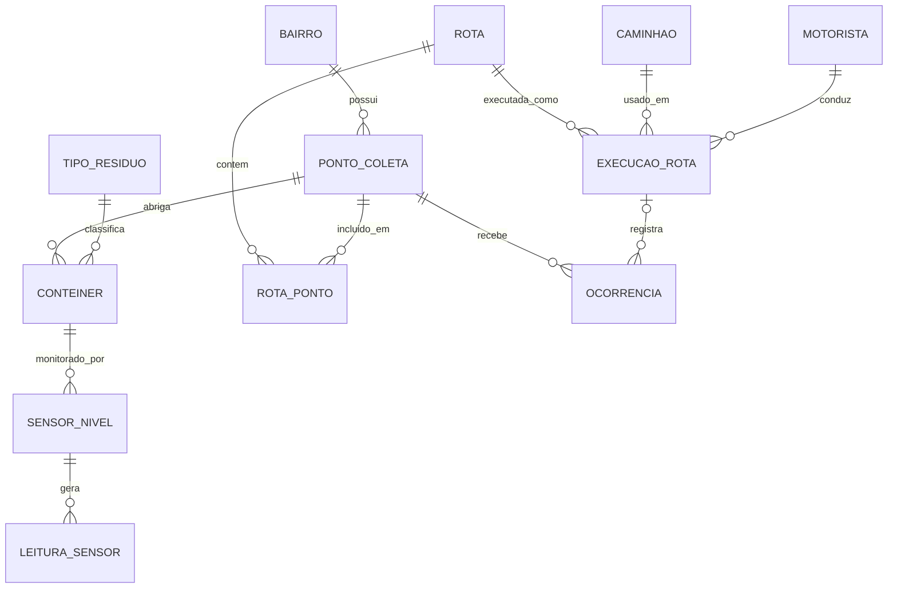

# EcoRota

**Otimização de rotas de coleta de lixo com banco de dados e sensores de nível.**

Projeto acadêmico (A3) do curso de Análise e Desenvolvimento de Sistemas da Universidade Anhembi Morumbi.

Autores: Enzo Hayashi Lascala e Kaique Pereira Franceslino.

---

## Sumário

1. [Objetivo e contexto](#objetivo-e-contexto)
2. [Funcionalidades](#funcionalidades)
3. [Arquitetura e organização do código](#arquitetura-e-organização-do-código)
4. [Tecnologias e decisões técnicas](#tecnologias-e-decisões-técnicas)
5. [Modelo de dados](#modelo-de-dados)
6. [Como a otimização funciona](#como-a-otimização-funciona)
7. [API](#api)
8. [Como executar](#como-executar)
9. [Evidências e resultados](#evidências-e-resultados)
10. [Desafios, limitações e melhorias futuras](#desafios-limitações-e-melhorias-futuras)

---

## Objetivo e contexto

### Problema

Na coleta de lixo urbana tradicional, as rotas seguem um roteiro fixo, percorrido por inteiro independentemente de quanto cada contêiner acumulou. Isso gera:

- caminhões passando por pontos praticamente vazios;
- pontos cheios que só são atendidos no ciclo seguinte, com risco de transbordamento;
- alto consumo de combustível e tempo de deslocamento;
- coleta desbalanceada entre bairros.

O problema central não está na frota nem nas equipes, mas na forma como as rotas são definidas: sem dados sobre a ocupação real dos contêineres e sem histórico para ajustar o trajeto.

### Objetivo

Substituir o roteiro fixo por uma **rota dinâmica**, montada a partir de três elementos:

1. **Dados de sensores de nível** dos contêineres, armazenados em banco de dados.
2. **Histórico de rotas** executadas (distância, tempo, combustível e volume coletado).
3. **Otimização dinâmica de percursos**, que seleciona apenas os contêineres que precisam de coleta e define a ordem de visita.

Esses três itens são os requisitos priorizados do projeto.

---

## Funcionalidades

| Código | Funcionalidade | Prioridade | Situação |
|---|---|---|---|
| RF01 | Armazenar leituras periódicas dos sensores de nível (percentual e data/hora) | Alta | Implementado |
| RF02 | Guardar o histórico das rotas executadas | Alta | Implementado |
| RF03 | Montar a rota do dia dinamicamente, só com contêineres acima de um limite de ocupação | Alta | Implementado |
| RF04 | Comparar rota fixa e rota otimizada (distância, combustível e tempo) | Média | Implementado |
| RF05 | Cadastro de bairros, pontos, contêineres, sensores, caminhões e motoristas | Média | Dados carregados por script, sem telas de cadastro |
| RF06 | Registro de ocorrências (transbordamento, atraso, contêiner danificado) | Baixa | Tabela criada, sem tela |

Na interface web é possível:

- visualizar os pontos de coleta e a rota otimizada em um mapa, numerada pela ordem de visita;
- ajustar o limite de ocupação e ver a rota ser recalculada na hora;
- comparar a rota fixa com a rota otimizada;
- registrar a execução de uma rota, que entra no histórico e esvazia os contêineres coletados;
- simular novas leituras dos sensores para observar a rota mudar.

---

## Arquitetura e organização do código

```
coleta-lixo/
├── schema.sql    # estrutura do banco: 12 tabelas, chaves, restrições e índice
├── seed.sql      # dados de exemplo (fictícios) e a rota fixa atual
├── server.py     # backend: criação do banco, API REST e algoritmo de otimização
├── index.html    # frontend: mapa, comparação, contêineres e histórico
└── coleta.db     # banco SQLite, gerado na primeira execução
```

Fluxo geral:

```
Navegador (index.html)  <--fetch/JSON-->  server.py (API)  <--sqlite3-->  coleta.db
```

Organização do `server.py`, por blocos:

| Bloco | Responsabilidade |
|---|---|
| Banco de dados | Conexão, criação do banco na primeira execução, geração de leituras e histórico iniciais |
| Consultas | Última leitura de cada contêiner, rota fixa, histórico |
| Otimização | Distância (Haversine), seleção dos contêineres, ordenação (vizinho mais próximo), comparação |
| Ações | Simulação de leituras e registro de execução de rota |
| Servidor HTTP | Rotas da API e entrega do `index.html` |

---

## Tecnologias e decisões técnicas

| Camada | Escolha | Justificativa |
|---|---|---|
| SGBD | SQLite | Relacional, em arquivo único, sem instalação nem servidor. Suporta chaves estrangeiras, índices e SQL padrão, suficiente para o protótipo. |
| Backend | Python 3 (`http.server`, `sqlite3`, `json`, `math`) | Usa apenas a biblioteca padrão: nada para instalar e código curto e legível. |
| Frontend | HTML, CSS e JavaScript puros | Roda direto no navegador e consome a API com `fetch`. O mapa é um SVG gerado a partir de latitude e longitude. |
| Algoritmo | Vizinho mais próximo + distância de Haversine | Heurística simples e explicável, suficiente para demonstrar o ganho em distância, tempo e combustível. |

Decisões de projeto relevantes:

- **Leituras nunca são sobrescritas.** Cada leitura gera uma nova linha em `leitura_sensor`; o nível atual de um contêiner é a leitura mais recente do seu sensor. Isso preserva o histórico para análises futuras.
- **Índice em `leitura_sensor(id_sensor, timestamp_leitura)`**, por ser a tabela de maior volume e a consulta da última leitura ser a mais frequente.
- **Integridade referencial** por chaves estrangeiras (`PRAGMA foreign_keys = ON`) e restrição `CHECK` limitando o nível entre 0 e 100.
- **Sem dependências externas**, para que o projeto rode em qualquer máquina com Python.

---

## Modelo de dados

O banco possui 12 tabelas, organizadas em quatro grupos:

- **Localização:** `bairro`, `ponto_coleta`, `tipo_residuo`, `conteiner`
- **Monitoramento:** `sensor_nivel`, `leitura_sensor`
- **Planejamento e operação:** `rota`, `rota_ponto` (associativa N:M com a ordem de visita), `caminhao`, `motorista`, `execucao_rota`
- **Incidentes:** `ocorrencia`



Atributos, tipos e chaves de cada tabela estão em [`schema.sql`](schema.sql).

---

## Como a otimização funciona

1. **Seleção:** são escolhidos os contêineres cuja última leitura é maior ou igual ao limite de ocupação (padrão de 70%).
2. **Ordenação:** heurística do **vizinho mais próximo**. Partindo da garagem, o caminhão vai sempre ao ponto ainda não visitado mais perto e, ao final, retorna à garagem.
3. **Distância:** fórmula de **Haversine** (latitude e longitude), multiplicada por um fator urbano de 1,3 para compensar que as ruas não seguem linha reta.
4. **Combustível:** distância dividida pelo consumo médio do caminhão (km/L).
5. **Tempo:** distância dividida por 25 km/h, mais 3 minutos de parada por contêiner.
6. **Comparação:** os mesmos cálculos são feitos para a rota fixa atual (todos os pontos, na ordem original), e a economia é calculada em percentual de distância e litros de combustível.

Ao registrar uma execução, o sistema cria uma nova `rota` com seus `rota_ponto`, grava a `execucao_rota` (distância, combustível, volume estimado e horários) e insere uma nova leitura de nível 0 para cada contêiner coletado.

Os parâmetros (garagem, fator urbano, velocidade, tempo por parada, densidade do lixo) ficam no início do `server.py` e podem ser ajustados.

---

## API

| Método | Endereço | Função |
|---|---|---|
| GET | `/api/conteineres` | Lista os contêineres com a última leitura de cada sensor |
| GET | `/api/plano?limite=70` | Calcula e compara a rota fixa e a otimizada |
| GET | `/api/historico` | Retorna as últimas 10 execuções |
| POST | `/api/simular` | Registra novas leituras mais altas em todos os sensores |
| POST | `/api/executar` | Grava a rota otimizada no histórico e esvazia os contêineres coletados |

Exemplo:

```
GET http://localhost:8000/api/plano?limite=70
```

---

## Como executar

### Requisitos

- Python 3 instalado
- Um navegador

Não há dependências para instalar.

### Passos

1. Coloque `server.py`, `index.html`, `schema.sql` e `seed.sql` na mesma pasta.
2. Abra a pasta no VSCode e abra o terminal.
3. Execute:

   ```
   python server.py
   ```

   (em alguns sistemas, `python3 server.py`)
4. Acesse **http://localhost:8000** no navegador.

Na primeira execução, o arquivo `coleta.db` é criado automaticamente com os dados de exemplo, 6 leituras por sensor e 5 execuções históricas. Para reiniciar com dados novos, apague o `coleta.db` e execute novamente.

### Consultando o banco

Com a extensão **SQLite** (alexcvzz) do VSCode ou com o `sqlite3` no terminal, abra o `coleta.db`. Exemplo, último nível de cada contêiner:

```sql
SELECT c.id_conteiner, p.endereco, l.nivel_percentual, l.timestamp_leitura
FROM conteiner c
JOIN ponto_coleta p ON p.id_ponto = c.id_ponto
JOIN sensor_nivel s ON s.id_conteiner = c.id_conteiner
JOIN leitura_sensor l ON l.id_sensor = s.id_sensor
WHERE l.id_leitura = (SELECT MAX(id_leitura) FROM leitura_sensor WHERE id_sensor = s.id_sensor)
ORDER BY l.nivel_percentual DESC;
```

---

## Evidências e resultados

### Teste com dados de exemplo

Em uma execução de teste, com limite de ocupação de 70% e os dados de exemplo gerados pelo sistema:

| | Rota fixa | Rota EcoRota |
|---|---|---|
| Pontos visitados | 12 | 3 |
| Distância | 69,6 km | 13,1 km |

Economia de cerca de **81% na distância**. Os valores mudam se os dados forem regerados ou se o limite for alterado, e os sensores são simulados; o resultado demonstra o comportamento do método, não um ganho medido em campo.

### Capturas de tela

> Adicione as imagens em uma pasta `docs/` e ajuste os caminhos abaixo.

```


```

---

## Desafios, limitações e melhorias futuras

### Desafios técnicos

- Transformar leituras de sensores em uma decisão simples e explicável para quem opera a coleta (quais pontos visitar e em que ordem).
- Preservar o histórico completo de leituras sem perder a consulta rápida do nível atual de cada contêiner.
- Criar uma base de comparação justa (rota fixa x rota otimizada) com os mesmos critérios de distância, combustível e tempo.
- Manter o projeto sem dependências externas, mantendo o código acessível.

### Limitações

- O vizinho mais próximo gera uma boa rota, mas não garante a menor possível.
- A distância é estimada em linha reta com fator de correção, sem considerar trânsito nem sentido das vias.
- Os sensores são simulados, sem integração com dispositivos reais.
- Considera um único caminhão por rota.
- A tabela `ocorrencia` existe no banco, mas não tem tela no protótipo.

### Melhorias futuras

- Usar distâncias e tempos reais por uma API de mapas.
- Aplicar algoritmos de roteirização mais robustos.
- Considerar a capacidade de carga do caminhão e múltiplas rotas simultâneas.
- Criar telas de cadastro e de ocorrências.
- Migrar para SQL Server ou PostgreSQL, com particionamento da tabela `leitura_sensor` por data.

---

## Contexto acadêmico

Projeto desenvolvido na disciplina de Banco de Dados do curso de Análise e Desenvolvimento de Sistemas, Universidade Anhembi Morumbi, como parte da A3.
