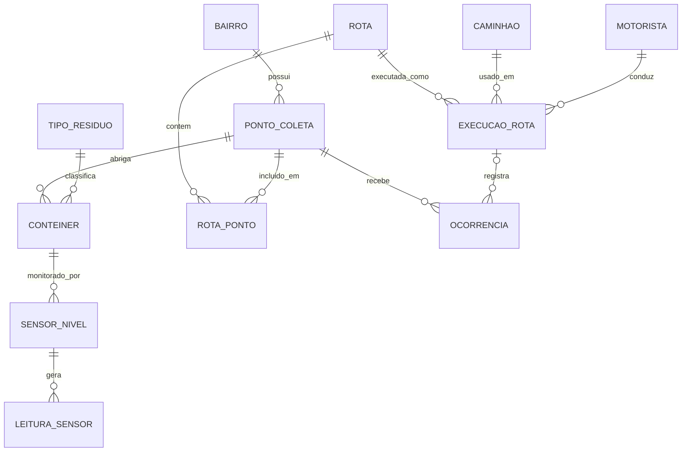

# EcoRota

Otimização de rotas de coleta de lixo com banco de dados e sensores de nível.

Projeto acadêmico (A3) do curso de Análise e Desenvolvimento de Sistemas da Universidade Anhembi Morumbi.
Autores: Enzo Hayashi Lascala e Kaique Pereira Franceslino.

## 1. Objetivo e contexto do projeto

Na coleta de lixo urbana tradicional, as rotas seguem um roteiro fixo, percorrido por inteiro independentemente de quanto cada contêiner acumulou. Isso gera caminhões passando por pontos praticamente vazios, pontos cheios que só são atendidos no ciclo seguinte, alto consumo de combustível, longos tempos de deslocamento e coleta desbalanceada entre bairros.

O problema central não está na frota nem nas equipes, mas na forma como as rotas são definidas: sem dados sobre a ocupação real dos contêineres e sem histórico para ajustar o trajeto.

O objetivo do projeto é substituir o roteiro fixo por uma rota dinâmica, montada a partir de três elementos, que correspondem aos requisitos priorizados:

- **Dados de sensores de nível** dos contêineres, armazenados em banco de dados.
- **Histórico de rotas** executadas (distância, tempo, combustível e volume coletado).
- **Otimização dinâmica de percursos**, que seleciona apenas os contêineres que precisam de coleta e define a ordem de visita.

## 2. Arquitetura e organização do código

```
coleta-lixo/
├── schema.sql    # estrutura do banco: 12 tabelas, chaves, restrições e índice
├── seed.sql      # dados de exemplo (fictícios) e a rota fixa atual
├── server.py     # backend: criação do banco, API REST e algoritmo de otimização
├── index.html    # frontend: mapa, comparação, contêineres e histórico
└── coleta.db     # banco SQLite, gerado na primeira execução
```

Fluxo geral:

```
Navegador (index.html)  <-- fetch / JSON -->  server.py (API)  <-- sqlite3 -->  coleta.db
```

Organização do `server.py`:

| Bloco | Responsabilidade |
|---|---|
| Banco de dados | Conexão, criação do banco na primeira execução, geração de leituras e histórico iniciais |
| Consultas | Última leitura de cada contêiner, rota fixa e histórico |
| Otimização | Distância (Haversine), seleção dos contêineres, ordenação (vizinho mais próximo) e comparação |
| Ações | Simulação de leituras e registro de execução de rota |
| Servidor HTTP | Rotas da API e entrega do `index.html` |

Modelo de dados: 12 tabelas, em quatro grupos.

- **Localização:** `bairro`, `ponto_coleta`, `tipo_residuo`, `conteiner`
- **Monitoramento:** `sensor_nivel`, `leitura_sensor`
- **Planejamento e operação:** `rota`, `rota_ponto` (associativa N:M, com a ordem de visita), `caminhao`, `motorista`, `execucao_rota`
- **Incidentes:** `ocorrencia`



Atributos, tipos e chaves de cada tabela estão em `schema.sql`.

## 3. Tecnologias utilizadas e justificativas das principais decisões

| Camada | Escolha | Justificativa |
|---|---|---|
| SGBD | SQLite | Relacional, em arquivo único, sem instalação nem servidor. Suporta chaves estrangeiras, índices e SQL padrão, suficiente para o protótipo. |
| Backend | Python 3 (`http.server`, `sqlite3`, `json`, `math`) | Usa apenas a biblioteca padrão: nada para instalar, código curto e legível. |
| Frontend | HTML, CSS e JavaScript puros | Roda direto no navegador e consome a API com `fetch`. O mapa é um SVG gerado a partir de latitude e longitude. |
| Algoritmo | Vizinho mais próximo + distância de Haversine | Heurística simples e explicável, suficiente para demonstrar o ganho em distância, tempo e combustível. |

Decisões de projeto relevantes:

- **Leituras nunca são sobrescritas.** Cada leitura gera uma nova linha em `leitura_sensor`, e o nível atual de um contêiner é a leitura mais recente do seu sensor. Isso preserva o histórico para análises futuras.
- **Índice em `leitura_sensor(id_sensor, timestamp_leitura)`**, por ser a tabela de maior volume e a consulta da última leitura ser a mais frequente.
- **Integridade referencial** por chaves estrangeiras (`PRAGMA foreign_keys = ON`) e restrição `CHECK` limitando o nível entre 0 e 100.
- **Sem dependências externas**, para que o projeto rode em qualquer máquina com Python.

## 4. Funcionalidades implementadas

- Armazenamento de leituras periódicas dos sensores de nível (percentual de ocupação e data/hora).
- Histórico de rotas executadas: distância, combustível, volume coletado, horários, caminhão e motorista.
- Geração da rota do dia de forma dinâmica, visitando apenas contêineres acima de um limite de ocupação, na ordem do caminho mais curto.
- Comparação entre a rota fixa atual e a rota otimizada (pontos visitados, distância, combustível e tempo).
- Mapa com os pontos de coleta e a rota numerada pela ordem de visita.
- Ajuste do limite de ocupação, com recálculo imediato da rota.
- Registro da execução de uma rota, que entra no histórico e esvazia os contêineres coletados.
- Simulação de novas leituras dos sensores, para observar a rota mudar.

Como a otimização funciona:

1. **Seleção:** são escolhidos os contêineres cuja última leitura é maior ou igual ao limite de ocupação (padrão de 70%).
2. **Ordenação:** heurística do vizinho mais próximo. Partindo da garagem, o caminhão vai sempre ao ponto ainda não visitado mais perto e, ao final, retorna à garagem.
3. **Distância:** fórmula de Haversine, multiplicada por um fator urbano de 1,3 para compensar que as ruas não seguem linha reta.
4. **Combustível:** distância dividida pelo consumo médio do caminhão (km/L).
5. **Tempo:** distância dividida por 25 km/h, mais 3 minutos de parada por contêiner.
6. **Comparação:** os mesmos cálculos são feitos para a rota fixa atual, e a economia é calculada em percentual de distância e litros de combustível.

Os parâmetros (garagem, fator urbano, velocidade, tempo por parada) ficam no início do `server.py` e podem ser ajustados.

API:

| Método | Endereço | Função |
|---|---|---|
| GET | `/api/conteineres` | Lista os contêineres com a última leitura de cada sensor |
| GET | `/api/plano?limite=70` | Calcula e compara a rota fixa e a otimizada |
| GET | `/api/historico` | Retorna as últimas 10 execuções |
| POST | `/api/simular` | Registra novas leituras mais altas em todos os sensores |
| POST | `/api/executar` | Grava a rota otimizada no histórico e esvazia os contêineres coletados |

## 5. Instruções para executar o projeto

Requisitos: Python 3 e um navegador. Não há dependências para instalar.

1. Coloque `server.py`, `index.html`, `schema.sql` e `seed.sql` na mesma pasta.
2. Abra a pasta no terminal (ou no terminal do VSCode).
3. Execute:

   ```
   python server.py
   ```

   Em alguns sistemas, o comando é `python3 server.py`.
4. Acesse `http://localhost:8000` no navegador.

Na primeira execução, o arquivo `coleta.db` é criado automaticamente com os dados de exemplo, 6 leituras por sensor e 5 execuções históricas. Para reiniciar com dados novos, apague o `coleta.db` e execute novamente.

## 6. Evidências, exemplos de utilização e resultados

### Exemplo de uso da API

```
GET http://localhost:8000/api/plano?limite=70
```

A resposta traz a rota fixa, a rota otimizada (com a ordem de visita de cada contêiner) e a economia calculada.

### Exemplo de consulta ao banco

Último nível de cada contêiner:

```sql
SELECT c.id_conteiner, p.endereco, l.nivel_percentual, l.timestamp_leitura
FROM conteiner c
JOIN ponto_coleta p ON p.id_ponto = c.id_ponto
JOIN sensor_nivel s ON s.id_conteiner = c.id_conteiner
JOIN leitura_sensor l ON l.id_sensor = s.id_sensor
WHERE l.id_leitura = (SELECT MAX(id_leitura) FROM leitura_sensor WHERE id_sensor = s.id_sensor)
ORDER BY l.nivel_percentual DESC;
```

### Resultado em teste

Em uma execução de teste, com limite de ocupação de 70% e os dados de exemplo gerados pelo sistema:

| | Rota fixa | Rota EcoRota |
|---|---|---|
| Pontos visitados | 12 | 3 |
| Distância | 69,6 km | 13,1 km |

Economia de cerca de 81% na distância. Os valores mudam se os dados forem regerados ou se o limite for alterado. Os sensores são simulados, então o resultado demonstra o comportamento do método e não um ganho medido em campo.

## 7. Desafios técnicos, aprendizados e possíveis melhorias futuras

### Desafios técnicos

- Transformar leituras de sensores em uma decisão simples e explicável: quais pontos visitar e em que ordem.
- Preservar o histórico completo de leituras sem perder a consulta rápida do nível atual de cada contêiner.
- Criar uma base de comparação justa entre rota fixa e rota otimizada, com os mesmos critérios de distância, combustível e tempo.
- Manter o projeto sem dependências externas, com código acessível.

### Aprendizados

- A modelagem do banco define o que o sistema consegue fazer: guardar leituras e execuções como histórico é o que torna a otimização possível.
- Uma heurística simples, quando alimentada por dados confiáveis, já produz ganho expressivo em relação a um roteiro fixo.
- Comparar o resultado com uma linha de base (a rota fixa) é essencial para demonstrar o valor da solução.
- Documentar decisões e limitações facilita a manutenção e a avaliação do projeto.

### Limitações

- O vizinho mais próximo gera uma boa rota, mas não garante a menor possível.
- A distância é estimada em linha reta com fator de correção, sem considerar trânsito nem sentido das vias.
- Os sensores são simulados, sem integração com dispositivos reais.
- Considera um único caminhão por rota.
- A tabela `ocorrencia` existe no banco, mas não tem tela no protótipo.

### Possíveis melhorias futuras

- Usar distâncias e tempos reais por meio de uma API de mapas.
- Aplicar algoritmos de roteirização mais robustos.
- Considerar a capacidade de carga do caminhão e múltiplas rotas simultâneas.
- Criar telas de cadastro e de ocorrências.
- Migrar para SQL Server ou PostgreSQL, com particionamento da tabela `leitura_sensor` por data.
